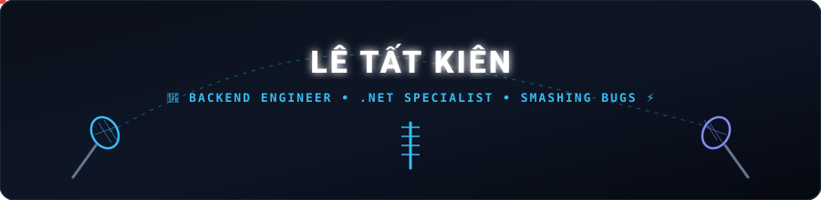

<!-- ==================== ANIMATED BADMINTON RALLY HEADER ==================== -->

  

<!-- ==================== BRIGHT ANIMATED TYPING BIO ==================== -->

  

<!-- ==================== SOCIAL & CONTACT BUTTONS ==================== -->

  
  
  
  

  📍 <b>Location:</b> Da Nang, Vietnam &nbsp;|&nbsp; 
  🎓 <b>Education:</b> Software Engineering @ FPT University Da Nang (Expected 2026)

---

### 🚀 About Me

I am a Software Engineering student at **FPT University Da Nang** specializing in **Backend Development** with a core focus on the **.NET ecosystem**. Experienced in designing high-throughput RESTful Web APIs, architecting secure authentication/authorization systems, and optimizing database performance for real-world production workloads.

- 🔭 **Current Focus:** Microservices Architecture, Clean Architecture (CQRS / MediatR), and Low-latency ASP.NET Core APIs.
- 💼 **Experience:** Former Software Developer Intern at **FPT Software**.
- 🛠️ **Engineering Mindset:** Prioritizing scalable solutions, clean code, automated workflows, and rock-solid architectural patterns.
- 💬 **Ask me about:** C#, ASP.NET Core, EF Core, SQL Server / PostgreSQL query tuning, and Redis caching.

---

### 🏛️ Engineering Philosophy & Core Focus

- 🏛️ **Clean Architecture & CQRS:** Decoupling Domain, Application, and Infrastructure layers; implementing MediatR & FluentValidation for high testability and maintainability.
- ⚡ **High-Performance & Low Latency:** Optimizing asynchronous execution (async/await), minimizing memory allocations, and leveraging **Redis** distributed caching for sub-millisecond responses.
- 🗄️ **Database Engineering:** Designing normalized relational schemas, analyzing Query Execution Plans, and applying strategic indexing across **SQL Server & PostgreSQL**.
- 📡 **Real-Time & Background Processing:** Delivering instant events via **SignalR WebSockets**, coordinating decoupled background tasks with Hosted Services.
- 🛡️ **Security & Identity:** Implementing JWT with refresh token rotation, Google OAuth SSO, role-based access control (RBAC), and brute-force protection.

---

### 🛠️ Tech Stack & Tooling

  

 

  
<b>🚀 Detailed Stack Breakdown (Click to expand/collapse)</b>

   

  - **Backend & Core:** C#, .NET 9/10, ASP.NET Core Web API, Entity Framework Core, SignalR, MediatR, FluentValidation.
  - **Databases & Caching:** Microsoft SQL Server, PostgreSQL, Redis, Supabase, Firebase.
  - **Architecture & Patterns:** Clean Architecture, CQRS, Repository & Unit of Work, RESTful API Design.
  - **Cloud, DevOps & Tooling:** Docker, Cloudflare R2 / CDN, Git, GitHub Actions, Postman, Swagger/OpenAPI.
  - **Frontend Supporting:** React 19, TypeScript, Tailwind CSS.

---

### 📊 GitHub Activity & Analytics

  

  

---

### 🕹️ Dynamic Contribution Graph

<picture>
  <source media="(prefers-color-scheme: dark)" srcset="https://raw.githubusercontent.com/NeikEl04/NeikEl04/output/github-snake-dark.svg">
  <source media="(prefers-color-scheme: light)" srcset="https://raw.githubusercontent.com/NeikEl04/NeikEl04/output/github-snake.svg">
  
</picture>

---

  🏸 <i>"Stay light on your feet, anticipate the next play, and smash every bug right down the line."</i>

